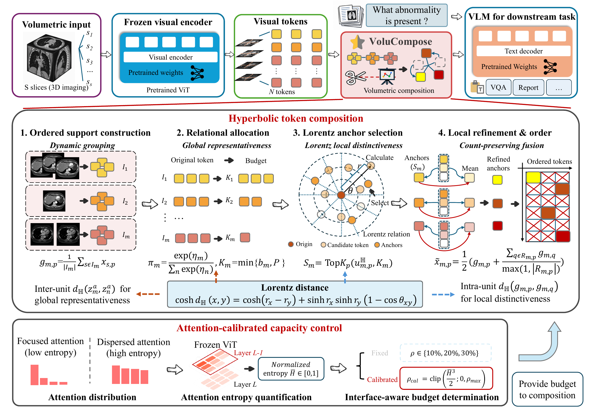

# VoluCompose

**Constructing Compact Volumetric Visual Representations for Medical Image Understanding**

[English](README.md) · [简体中文](README_CN.md) · [Evaluation protocol](docs/EVALUATION.md) · [MIT license](LICENSE)

VoluComposeis a **training-free visual-token compression framework** for volumetric medical vision–language models. It takes the ordered visual features of a CT/MRI slice sequence and produces a shorter, ordered visual sequence for the language model. All backbone parameters remain frozen; no pruning policy is trained.

<p align="center">
  
</p>

[Original framework figure (PDF)](assets/main_architecture.pdf)

The content path groups recurrent contiguous slices into ordered support units, allocates capacity to those units, selects distinctive anchors through radial–angular feature relations, and refines anchors with related local features. A separate capacity path supports either a fixed budget or an attention-entropy-calibrated budget. Compression is applied after native visual encoding and before the retained visual sequence enters language decoding.

## Supported backbones and tasks

The Transformers adapters support the following backbone and compression-method combinations.

| Backbone | `MODEL_NAME` | VoluCompose| Included comparison adapters |
| --- | --- | --- | --- |
| Qwen2.5-VL | `Qwen2.5-VL` | ✓ | VisionZip, HoliTom, UniComp |
| Qwen3-VL | `Qwen3-VL` | ✓ | VisionZip, HoliTom, UniComp |
| Hulu-Med (Qwen2) | `Hulumed_qwen2` | ✓ | VisionZip, HoliTom, UniComp |
| MedGemma | `MedGemma` | ✓ | VisionZip, HoliTom, UniComp |

| Benchmark | Exact CLI name | Task in this repository | Annotation file |
| --- | --- | --- | --- |
| AMOS-MM | `Amos` | CT report generation | `amos_val_mrg_sft.json` |
| M3D | `M3D` | Open and closed volumetric visual question answering | `M3D_test.json` |
| 3D-RAD | `3DRad` | Open and closed volumetric visual question answering | `Rad3D_test.json` |

The evaluation inputs are **preprocessed slice-image directories** referenced by annotation JSON files. The current loaders do not directly evaluate raw NIfTI volumes, perform lesion segmentation, or guarantee support for arbitrary DICOM files.

## Installation

Use Linux with an NVIDIA GPU for model inference. The supplied adapters use FlashAttention 2. Choose the PyTorch/CUDA build appropriate to your server; the following is a CUDA 12.4 example:

```bash
git clone https://github.com/yezanting/MedPruner-plus-plus.git
cd MedPruner-plus-plus
conda create -n medprunerpp python=3.10 -y
conda activate medprunerpp

python -m pip install torch==2.6.0 torchvision==0.21.0 --index-url https://download.pytorch.org/whl/cu124
python -m pip install packaging ninja
python -m pip install -r requirements.txt
python -m pip install flash-attn==2.7.3 --no-build-isolation
python -m pip install -e ./medcompose
python -m nltk.downloader wordnet omw-1.4
```

`transformers==4.57.3` matches the Qwen3-VL modules and decorator APIs used by the vendored model backends. The original environment list is retained as `requirements-legacy.txt` for provenance; it pins an older Transformers version and is not the release installation recipe.

## Data and model preparation

Follow the [Hulu-Med evaluation data instructions](https://github.com/ZJUI-AI4H/Hulu-Med/tree/main/MedUniEval) and its [processed evaluation resources](https://modelscope.cn/models/Med-Team/Hulu-Med). Obtain datasets and checkpoints under their respective access and license terms; this repository does not distribute them.

```text
data/Eval/
├── Amos/
│   ├── amos_val_mrg_sft.json
│   └── amos_test_crop_32/
├── M3D/
│   └── M3D_test.json
└── 3DRad/
    └── Rad3D_test.json
```

Each annotation's `video[0]` must point to an existing directory containing the ordered slice images. Update paths to your actual data location. Relative paths resolve from the repository root when using the provided launchers. Filenames must sort in anatomical slice order, for example `0001.png`, `0002.png`, … . Model paths may be local checkpoint directories or compatible model identifiers, subject to the model's access requirements.

## Compression configuration

Both the method selector and the JSON key are **`medpruner++`**. The Python module is `medcompose.medpruner_pp`.

```json
{
  "medpruner++": {
    "frame_uniqueness": 0.005,
    "retain_ratio": 0.1,
    "spatial_uniqueness": 0.2,
    "auto_compress": false
  }
}
```

This is the VoluComposesection of [`config/config.json`](config/config.json), which also contains baseline configurations.

| Parameter | Default | Meaning in the implementation |
| --- | --- | --- |
| `frame_uniqueness` | `0.005` | Lorentz-distance threshold for grouping contiguous slices against the first slice of the active support unit. Larger values permit more grouping; aggregation averages corresponding native features. |
| `retain_ratio` | `0.1` | Requested visual-token retention fraction relative to the original encoded sequence when `auto_compress=false`. |
| `spatial_uniqueness` | `0.2` | Local refinement threshold: a patch is an anchor's neighbor when `1 - S < threshold`, where `S` is row-normalized negative Lorentz distance. It does not set the TopK anchor count. |
| `auto_compress` | `false` | If true, replace the fixed budget with `rho = clamp(mean(H_normalized)^3 / 2, 0, 0.3)` from the available visual attention. |

Use a positive retention ratio at most 1 for fixed-budget runs. Automatic capacity is computed from the input attention instead of using `retain_ratio`.

The model attribute `compression_rate` and output field `compose_rates.compose_rate` both mean **retained visual tokens / original visual tokens**. Support-unit capacities and integer allocation can make the realized count smaller than the requested budget.

## Evaluation

From the repository root, run an AMOS report-generation evaluation:

```bash
CUDA_VISIBLE_DEVICES=0 \
MODEL_NAME=Hulumed_qwen2 \
MODEL_PATH=/path/to/Hulu-Med-7B \
DATASETS_PATH=/path/to/Eval \
EVAL_DATASETS=Amos \
COMPRESSION=VoluCompose\
OUTPUT_PATH=workspace/eval/hulu-amos-medprunerpp \
bash MedUniEval/eval.sh
```

For M3D, the chunked launcher runs shards **sequentially**, using the visible GPU set for each model instance. It does not launch independent GPU workers:

```bash
CUDA_VISIBLE_DEVICES=0 \
MODEL_NAME=Qwen3-VL \
MODEL_PATH=/path/to/Qwen3-VL-8B-Instruct \
DATASETS_PATH=/path/to/Eval \
CHUNKS=8 \
COMPRESSION=VoluCompose\
OUTPUT_PATH=workspace/eval/qwen3-m3d-medprunerpp \
bash MedUniEval/eval_M3D_chunked.sh
```

Set `EVAL_DATASETS=3DRad` with `eval.sh` for 3D-RAD. Set `COMPRESSION=none` for the uncompressed reference, or `visionzip`, `holitom`, `unicomp` for the included comparison implementations. Use a **different output directory per method/configuration**. Keep the checkpoint, input sampling, prompt, generation settings and metric code matched between runs.

| Variable | `eval.sh` default | M3D launcher default |
| --- | --- | --- |
| `EVAL_DATASETS` | `3DRad,Amos` | `M3D` |
| `MODEL_NAME` | `Hulumed_qwen2` | `Hulumed_qwen2` |
| `MODEL_PATH` | `workspace/model/hulu_7B` | Same |
| `DATASETS_PATH` | `data/Eval` | Same |
| `CONFIG_PATH` | `config/config.json` | Same |
| `COMPRESSION` | `medpruner++` | Same |
| `CUDA_VISIBLE_DEVICES` | `0` | `0` |
| `MAX_NEW_TOKENS` | `16384` | `256` |
| `MAX_IMAGE_NUM` | `600` | `600` |
| `SEED`, `TEMPERATURE`, `TOP_P` | `42`, `0`, `0.95` | Same |
| `USE_VLLM`, `USE_LLM_JUDGE` | `False`, `False` | Same |
| `CHUNKS` | Single run | `8` sequential shards |

The compression release uses Transformers adapters. `MAX_IMAGE_NUM` limits sampling in the M3D loader; the inherited 3D-RAD loader uses `max_frames=1800`, and AMOS loads its supplied crop sequence. See [data loading and evaluation logic](docs/EVALUATION.md).

M3D and 3D-RAD save `results.json`, `metrics.json`, and `wrong_answers.json` under the dataset output directory. AMOS saves generated reports and CSV exports; its first `metrics.json` is an instruction to run the separate [report metric script](MedUniEval/utils/Metrics_Compute/cal_report_metrics.py), not a final report score.

## Code structure and tests

| Path | Role |
| --- | --- |
| `medcompose/medpruner_pp/` | Compression logic and model-specific visual-token adapters. |
| `medcompose/medpruner_pp/utils.py` | Ordered support construction, capacity allocation, anchor selection and refinement. |
| `config/config.json` | Compression-method parameters. |
| `MedUniEval/eval.py` | Evaluation argument parsing, model loading and dataset dispatch. |
| `MedUniEval/models/` | Backbone wrappers that connect processors, generation and retention metadata. |
| `MedUniEval/utils/` | Dataset loaders, prompt formatting, shard aggregation and metric calculation. |
| `demo/` | Backbone-specific inference examples; set the model and image paths before running. |
| `tests/` | Local tests for compression, launchers, imports and packaging. |

Run the local tests from the repository root:

```bash
python -m pip install build wheel
python -m unittest discover -s tests -v
```

The tests use synthetic features and stub generation to exercise compression and launcher logic without downloading model weights. Mathematical tests require PyTorch and Geoopt; wheel tests require `build`. Dataset evaluation uses the commands above after preparing the model and slice data.

## Citation and acknowledgements

The manuscript metadata below comes from the author-provided draft. No published venue or DOI is asserted. [`CITATION.cff`](CITATION.cff) also provides a repository citation.

```bibtex

```

This work builds on [MedPruner](https://github.com/Saint-lsy/MedPruner) and uses an evaluation framework adapted from [Hulu-Med](https://github.com/ZJUI-AI4H/Hulu-Med). We acknowledge [Transformers](https://github.com/huggingface/transformers), [Qwen-VL](https://github.com/QwenLM/Qwen3-VL), [MedGemma](https://github.com/google-health/medgemma), [VisionZip](https://github.com/JIA-Lab-research/VisionZip), [HoliTom](https://github.com/cokeshao/HoliTom), and [UniComp](https://github.com/TimeMarker-LLM/UniComp).

- [MedPruner: Training-Free Hierarchical Token Pruning for Efficient 3D Medical Image Understanding in Vision-Language Models](https://arxiv.org/abs/2603.11625)
- [Hulu-Med: A Transparent Generalist Model towards Holistic Medical Vision-Language Understanding](https://arxiv.org/abs/2510.08668)

## License

VoluComposeproject contributions are released under the [MIT License](LICENSE). Vendored and adapted third-party code retains its original copyright notices and license terms, including Apache 2.0; see [THIRD_PARTY_NOTICES.md](THIRD_PARTY_NOTICES.md). Dataset and pretrained-weight licenses remain separate.
