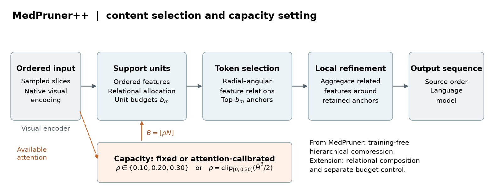

# MedPruner++

**Constructing Compact Volumetric Visual Representations for Medical Image Understanding**

[English](README.md) · [简体中文](README_CN.md) · [评估协议](docs/EVALUATION.md) · [MIT 许可证](LICENSE)

MedPruner++ 是面向体积医学视觉语言模型的**无需训练的视觉 token 压缩框架**。输入是 CT/MRI 切片序列经过视觉编码器得到的有序特征，输出是送入语言模型的更短、有序视觉序列。骨干参数保持冻结，不训练额外的剪枝策略。

例如，一次检查由 32 张切片表示，每张切片产生 256 个视觉 token，共有 8,192 个。设置 `retain_ratio=0.1` 后，请求的总容量为 `floor(8192 × 0.1) = 819` 个 token。由于支持单元容量限制和整数分配，实际保留数可能更少。这里控制的是视觉 token 预算，不是切片保留比例，也不代表运行速度必然提高某个固定倍数。

<p align="center">
  
</p>

内容路径先将重复的连续相邻切片聚合为有序支持单元，再分配单元容量，通过径向—角向特征关系选择具有独特性的锚点，并利用相关局部特征细化锚点。独立的容量路径支持固定预算或基于注意力熵的预算校准。压缩发生在原生视觉编码之后、保留的视觉序列进入语言解码之前。

## 支持的骨干和任务

下表列出发布代码提供的 Transformers 适配器。适配器存在不等同于已在你的硬件上复现完整基准。

| 骨干 | `MODEL_NAME` 注册名 | MedPruner++ | 包含的对比实现 |
| --- | --- | --- | --- |
| Qwen2.5-VL | `Qwen2.5-VL` | ✓ | VisionZip、HoliTom、UniComp |
| Qwen3-VL | `Qwen3-VL` | ✓ | VisionZip、HoliTom、UniComp |
| Hulu-Med（Qwen2） | `Hulumed_qwen2` | ✓ | VisionZip、HoliTom、UniComp |
| MedGemma | `MedGemma` | ✓ | VisionZip、HoliTom、UniComp |

| 基准 | CLI 名称（大小写需一致） | 本仓库执行的任务 | 标注文件 |
| --- | --- | --- | --- |
| AMOS-MM | `Amos` | CT 报告生成 | `amos_val_mrg_sft.json` |
| M3D | `M3D` | 体积影像开放式及选择题问答 | `M3D_test.json` |
| 3D-RAD | `3DRad` | 体积影像开放式及选择题问答 | `Rad3D_test.json` |

评估入口读取标注 JSON 引用的**预处理切片图像目录**。现有加载器不直接评估原始 NIfTI 体积，不执行病灶分割，也不保证能解码任意 DICOM 文件。

## 安装

模型推理使用 Linux 和 NVIDIA GPU，适配器使用 FlashAttention 2。请按服务器选择对应的 PyTorch/CUDA 构建，下面以 CUDA 12.4 为例：

```bash
git clone https://github.com/yezanting/MedPruner-plus-plus.git
cd MedPruner-plus-plus
conda create -n medprunerpp python=3.10 -y
conda activate medprunerpp

python -m pip install torch==2.6.0 torchvision==0.21.0 --index-url https://download.pytorch.org/whl/cu124
python -m pip install packaging ninja
python -m pip install -r requirements.txt
python -m pip install flash-attn==2.7.3 --no-build-isolation
python -m pip install -e ./medcompose
python -m nltk.downloader wordnet omw-1.4
```

`transformers==4.57.3` 对应本仓库 Qwen3-VL 模块及内置模型使用的装饰器 API。原始依赖列表保留在 `requirements-legacy.txt` 中，供追溯环境使用；其中固定的旧版 Transformers 不适合作为这次发布的安装方案。包构建与导入检查范围见[评估说明](docs/EVALUATION.md)。

## 数据和模型准备

参照 [Hulu-Med 评估数据说明](https://github.com/ZJUI-AI4H/Hulu-Med/tree/main/MedUniEval)及其[处理后的评估资源](https://modelscope.cn/models/Med-Team/Hulu-Med)，按各自许可及访问条件获取数据和模型。本仓库不分发这些资源。

```text
data/Eval/
├── Amos/
│   ├── amos_val_mrg_sft.json
│   └── amos_test_crop_32/
├── M3D/
│   └── M3D_test.json
└── 3DRad/
    └── Rad3D_test.json
```

标注中的 `video[0]` 必须指向实际存在的有序切片目录。请按数据位置更新路径；使用启动脚本时，相对路径以仓库根目录为基准。文件名需按解剖切片顺序排序，例如 `0001.png`、`0002.png`。模型路径可以是本地检查点目录或兼容的模型标识符，仍需满足模型访问条件。

## 压缩配置

方法开关和 JSON 配置键均为 **`medpruner++`**，Python 模块名为 `medcompose.medpruner_pp`。

```json
{
  "medpruner++": {
    "frame_uniqueness": 0.005,
    "retain_ratio": 0.1,
    "spatial_uniqueness": 0.2,
    "auto_compress": false
  }
}
```

这是 [`config/config.json`](config/config.json) 中的 MedPruner++ 部分；该文件也包含其他对比方法的配置。

| 参数 | 默认值 | 代码中的实际含义 |
| --- | --- | --- |
| `frame_uniqueness` | `0.005` | 连续切片与当前支持单元第一张切片之间的 Lorentz 距离阈值。增大阈值允许更多分组，聚合按对应位置平均原生特征。 |
| `retain_ratio` | `0.1` | `auto_compress=false` 时，相对于原始编码序列的视觉 token 请求保留率。 |
| `spatial_uniqueness` | `0.2` | 局部细化的邻域阈值：`1 - S < threshold` 时该 patch 属于锚点邻域，其中 `S` 是逐行归一化的负 Lorentz 距离。该参数不决定 TopK 锚点数量。 |
| `auto_compress` | `false` | 开启后根据可用视觉注意力计算 `rho = clamp(mean(H_normalized)^3 / 2, 0, 0.3)`，替代固定预算。 |

固定预算使用大于 0、不超过 1 的保留率。自动容量随输入变化，上限是 30%，不等同于自动设置 10%。极小预算及退化特征或注意力输入需要单独验证。

模型属性 `compression_rate` 和结果字段 `compose_rates.compose_rate` 的含义均为**保留的视觉 token 数 / 原始视觉 token 数**。因此 `0.1` 表示保留 10%、约移除 90%。应检查实际保留率，不要假设它与请求预算完全相等。

## 评估

从仓库根目录执行 AMOS 报告生成：

```bash
CUDA_VISIBLE_DEVICES=0 \
MODEL_NAME=Hulumed_qwen2 \
MODEL_PATH=/path/to/Hulu-Med-7B \
DATASETS_PATH=/path/to/Eval \
EVAL_DATASETS=Amos \
COMPRESSION=medpruner++ \
OUTPUT_PATH=workspace/eval/hulu-amos-medprunerpp \
bash MedUniEval/eval.sh
```

M3D 的分片启动脚本**顺序执行**各分片，每次模型实例使用指定的可见 GPU 集合，不会启动每张 GPU 一个独立并行任务：

```bash
CUDA_VISIBLE_DEVICES=0 \
MODEL_NAME=Qwen3-VL \
MODEL_PATH=/path/to/Qwen3-VL-8B-Instruct \
DATASETS_PATH=/path/to/Eval \
CHUNKS=8 \
COMPRESSION=medpruner++ \
OUTPUT_PATH=workspace/eval/qwen3-m3d-medprunerpp \
bash MedUniEval/eval_M3D_chunked.sh
```

评估 3D-RAD 时，在 `eval.sh` 中设置 `EVAL_DATASETS=3DRad`。未压缩基线设置 `COMPRESSION=none`，其他内置对比方法设置 `visionzip`、`holitom` 或 `unicomp`。**不同方法或配置使用不同的输出目录**，并保持模型、输入采样、提示词、生成参数和指标代码一致。

| 环境变量 | `eval.sh` 默认值 | M3D 脚本默认值 |
| --- | --- | --- |
| `EVAL_DATASETS` | `3DRad,Amos` | `M3D` |
| `MODEL_NAME` | `Hulumed_qwen2` | `Hulumed_qwen2` |
| `MODEL_PATH` | `workspace/model/hulu_7B` | 同左 |
| `DATASETS_PATH` | `data/Eval` | 同左 |
| `CONFIG_PATH` | `config/config.json` | 同左 |
| `COMPRESSION` | `medpruner++` | 同左 |
| `CUDA_VISIBLE_DEVICES` | `0` | `0` |
| `MAX_NEW_TOKENS` | `16384` | `256` |
| `MAX_IMAGE_NUM` | `600` | `600` |
| `SEED`、`TEMPERATURE`、`TOP_P` | `42`、`0`、`0.95` | 同左 |
| `USE_VLLM`、`USE_LLM_JUDGE` | `False`、`False` | 同左 |
| `CHUNKS` | 单次运行 | `8`，顺序分片 |

本次压缩发布使用 Transformers 适配器。`MAX_IMAGE_NUM` 控制 M3D 的采样上限；继承的 3D-RAD 加载器使用 `max_frames=1800`，AMOS 则读取提供的裁剪切片序列。具体协议及与 Hulu-Med 的差异见 [docs/EVALUATION.md](docs/EVALUATION.md)。

M3D 和 3D-RAD 在各自输出目录保存 `results.json`、`metrics.json` 和 `wrong_answers.json`。AMOS 保存生成报告及 CSV；第一阶段的 `metrics.json` 只是提示后续运行[报告指标脚本](MedUniEval/utils/Metrics_Compute/cal_report_metrics.py)，并非最终报告分数。

## 引用和致谢

以下论文元数据来自作者提供的稿件，不声明已发表期刊或 DOI。[`CITATION.cff`](CITATION.cff) 同时提供仓库引用信息。

```bibtex
@misc{ye2026medprunerpp,
  title = {MedPruner++: Constructing Compact Volumetric Visual Representations for Medical Image Understanding},
  author = {Ye, Zanting and Lin, Yunrui and Liu, Shengyuan and Hao, Jing and Yuan, Yixuan and Zheng, Yefeng and Lu, Lijun},
  year = {2026},
  note = {Research manuscript; code release},
  url = {https://github.com/yezanting/MedPruner-plus-plus}
}
```

本研究基于 [MedPruner](https://github.com/Saint-lsy/MedPruner)，评估框架改编自 [Hulu-Med](https://github.com/ZJUI-AI4H/Hulu-Med)。感谢 [Transformers](https://github.com/huggingface/transformers)、[Qwen-VL](https://github.com/QwenLM/Qwen3-VL)、[MedGemma](https://github.com/google-health/medgemma)、[VisionZip](https://github.com/JIA-Lab-research/VisionZip)、[HoliTom](https://github.com/cokeshao/HoliTom) 和 [UniComp](https://github.com/TimeMarker-LLM/UniComp)。

- [MedPruner: Training-Free Hierarchical Token Pruning for Efficient 3D Medical Image Understanding in Vision-Language Models](https://arxiv.org/abs/2603.11625)
- [Hulu-Med: A Transparent Generalist Model towards Holistic Medical Vision-Language Understanding](https://arxiv.org/abs/2510.08668)

## 许可证

MedPruner++ 项目贡献采用 [MIT 许可证](LICENSE)。内置或改编的第三方代码保留原始版权声明和许可条件，包括 Apache 2.0，详见 [THIRD_PARTY_NOTICES.md](THIRD_PARTY_NOTICES.md)。数据集和预训练权重的许可独立适用。
